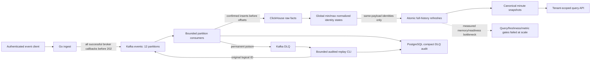
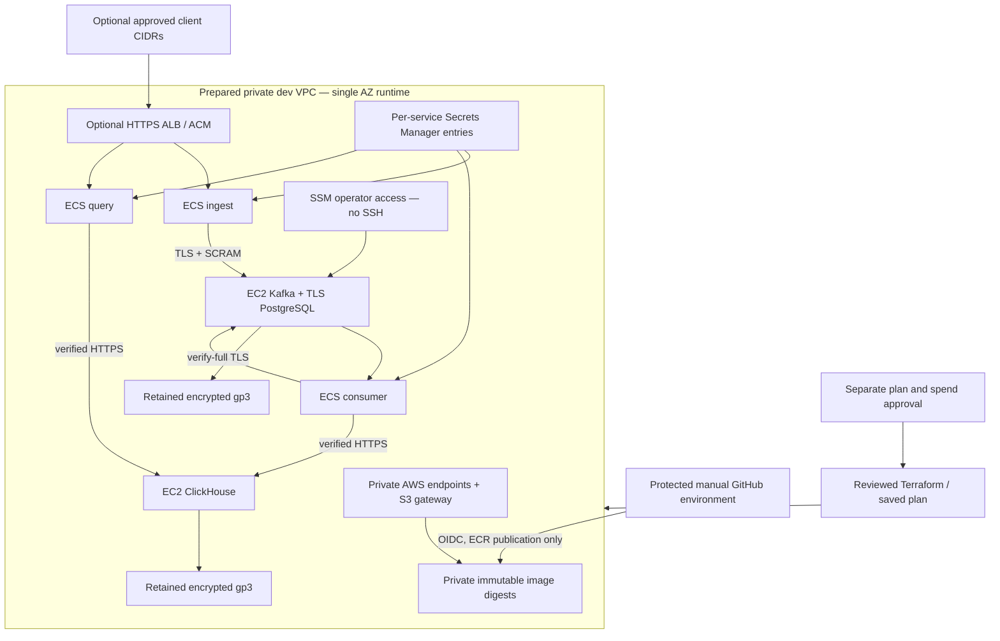

# Architecture and evidence boundary

Local pipeline/fault evidence is verified. The AWS drawing represents executable **offline-validated preparation**, not deployed resources. Two public subnets are created only for the opt-in ALB; database/broker ingress remains private. External HTTPS terminates at the ALB; the private target hop is HTTP. Root/server secrets do not enter Terraform state. The shared Kafka/PostgreSQL node is one administrative/failure boundary; no HA, automatic credential rotation or 24x7 operator guarantee is claimed. Cloud performance, negative IAM/SG checks and cleanup inventory remain unverified until an approved environment exists.
