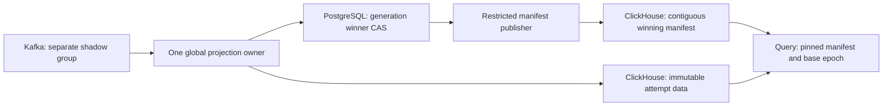

# Incremental analytics ownership and recovery — proposal, not approved integration

The generation/delta experiment is deliberately single-writer. A filesystem lock cannot establish ownership across hosts or independently configured processes. This document proposes the next protocol to test, not a production migration or authorization to change PostgreSQL/Kafka data flow. Keep the current consumer, canonical views and fail-closed query health in place.

## Why current Kafka partition ownership is insufficient

The production producer keys by `tenant_id:user_id` ([producer.go](../internal/broker/producer.go:65)). Conflicting variants of one global event ID may change either field and reach different partitions. The consumer processes assigned partitions concurrently and commits only successfully persisted partition prefixes ([consumer.go](../internal/broker/consumer.go:168), [commit](../internal/broker/consumer.go:245)). Its existing idempotent min/max sink tolerates this concurrency; the prototype's read/compute/write generation protocol does not.

Kafka group ownership controls Kafka consumption/offset commits. It does not make an independent ClickHouse write conditional on a current ownership epoch. Rechecking a lease or generation before INSERT leaves a check/write race. Stale data writes must remain invisible even after a newer owner publishes. See [Kafka delivery semantics](https://kafka.apache.org/40/design/design/#message-delivery-semantics).

The stress harness deliberately lets two workers with separate local lock roots both finish planning generation one before either writes. It then allows A to publish, pins a reader to generation one, and resumes B. A second schedule reuses the same ID with a conflicting payload: the stale worker fails verification, but its uncommitted deltas still affect the pinned snapshot. This proves that preventing the final commit alone does not isolate data. These are negative controls: reproducing exposure is a successful test of an **unsafe** protocol, not a concurrency safety pass. See [stress evidence/method](incremental-analytics-stress.md).

## Proposed invariant: immutable attempts plus one authoritative winner

Every data row must be keyed by `(projection, generation, attempt_uuid, logical_key)`. An attempt cannot overwrite another attempt, even when both use the same generation and event ID/bucket. Serving reads must include only the authoritative winning attempt of each committed generation. A losing/stale attempt may leave physical rows, but those rows cannot change an already-published snapshot.

An epoch/lease alone is insufficient: the publication authority must atomically choose the winner, and the data read path must enforce that choice. Workers must not have permission to insert served commit/winner records directly.

## Candidate to test: PostgreSQL batch-level publication CAS

Use the existing PostgreSQL service for a **batch/generation** coordinator, not per-event deduplication. This introduces a new synchronous correctness dependency at publication time and therefore remains a separate flow-design decision before integration. No coordinator table, role, migration or code is added by this proposal.

Proposed coordinator records:

- One projection head: committed generation, fencing epoch, owner/lease expiry, and all twelve source next-offsets.
- Immutable generation reservation: predecessor head/offset vector, source cluster/topic identity, observed source ranges, schema/normalizer version, exact recovery plan/input locator and attempt UUID.
- One winning attempt per generation, selected in a short transaction conditional on the current epoch, predecessor head and unexpired lease. A unique key and head-row lock/CAS serialize publication; a clock-only lease does not.

Do not hold a database transaction open during ClickHouse I/O. Reserve/claim, write attempt-scoped data, verify exact identity and bucket output, then perform the conditional publication transaction. `SELECT ... FOR UPDATE` can serialize the head-row decision, but the precise schema, predicates, retry behavior and stale-owner tests still need implementation. PostgreSQL documents its row-lock behavior [here](https://www.postgresql.org/docs/17/explicit-locking.html#LOCKING-ROWS).

A separate restricted publisher mirrors only committed winners to ClickHouse. Duplicate delivery of the same immutable winner is safe. Readers must validate a complete contiguous manifest prefix, not merely `max(generation)`; missing or conflicting winner records fail closed. A worker with data-only privileges cannot expose its losing attempt. Publication/mirror lag must be observable. An out-of-order mirror or duplicate/conflicting record must never silently skip a generation.

Estimated control-plane load, **not measurements**: at 10,000 events/s, 1,024-event batches require about 9.77 generation publications/s; 384-event batches require about 26.04/s. If reservation and publication each use one transaction, that is about 19.53 or 52.08 transactions/s plus lease/recovery work. Per-event dedup would instead require about 10,000 event-level operations/s. Plan bytes, SQL/WAL cost, p95 round trips and failure impact must be measured; these estimates do not establish feasibility or a throughput pass.

## Kafka offset and recovery rules

The first Kafka-connected trial should use a **new disposable/shadow group**, leaving the production group and retained facts unchanged. Start with one global owner across all twelve partitions because IDs can cross partitions. Do not claim 1→3 consumer scaling for a serialized publisher; concurrent preparation is a separate optimization after correctness.

For each generation, persist an immutable ordered source batch and its predecessor/next-offset vector. Kafka offsets may have legitimate gaps; the vector must never skip an unprocessed delivered record. Fixed source coordinates and exact recovery plans must survive changes in poll/flush boundaries. A retry must not reuse an attempt ID for different bytes or recompute against a different predecessor.

| Failure boundary | Required recovery |
|---|---|
| Before reservation | No visible data or offset advancement. Re-read the source prefix. |
| Reservation exists; partial/unknown ClickHouse write | Recover that reservation, verify/retry immutable attempt rows. Do not publish a later generation around it. |
| Data verified; CAS not committed | Read the authoritative winner/head after uncertainty. An expired or fenced attempt cannot win. |
| CAS committed; mirror absent/partial | Resume only the committed winner's manifest publication. Do not allow another winner or commit source offsets ahead of a readable generation. |
| ClickHouse manifest published; Kafka commit missing/partial | Recover the durable vector, verify manifest completeness, and reconcile/recommit offsets. Re-reading already-covered records must not create new contributions. |
| Assignment revoked/lost | Stop new work and Kafka commits immediately on the callback; cancel/wait bounded tasks. Any in-flight old ClickHouse attempt remains isolated. A failed fencing check cannot be bypassed by a stale worker. |
| Owner replacement while old process lives | Increment/fence the ownership epoch. New publication uses a new attempt; old attempts can never modify the committed read set. Test a delayed old server-side write after replacement, not only client cancellation. |
| Source retention no longer covers recovery prefix | Fail closed and require an explicit restore/recovery decision. Never jump to the broker's newest offset. |

The coordinator vector is the recovery authority for this proposed projection. On assignment, validate cluster/topic identity and retention bounds and seek explicitly to the verified prefix. Broker group offsets behind the verified vector indicate a recoverable commit gap; offsets unexpectedly ahead must block startup for investigation. Never mix checkpoints from the legacy consumer group, another projection, or another Kafka cluster. Include durable DLQ handling in any advancement rule; valid backlog must not be discarded as poison after an outage.

## Compaction must preserve pinned snapshots

The current generation key intentionally retains old identity versions and signed deltas. A normal merge cannot bound these histories without changing semantics. The hot-ID/bucket stress case measures that cost; dropping the generation key is unsafe because unpublished state could replace committed state.

Proposed compaction publishes a new **base epoch** at a verified committed generation H:

1. Read one pinned winner/offset prefix. Build new owned identity-base and bucket-base tables for H, keeping exact full min/max strings, conflicts and Int128 totals.
2. Independently reconcile every base ID/payload and bucket total against that prefix before publication. Tail changes after H remain attempt-scoped and separate.
3. Atomically publish `(base_epoch, base_head=H, tail_manifest_head)` through the same authority. A reader pins that tuple once and reads base plus only the matching tail.
4. Keep the prior base/tail while any valid pinned reader or recovery plan can reference it. Define reader leases/max lifetime and fail-closed expiry before garbage collection. A fixed delay without a reader-lifetime proof is insufficient.
5. Reclaim only proven unreachable owned generations after a separately reviewed retention/rollback procedure. No retained DROP, mutation, or journal cleanup is authorized here.

Identity conflict history must never be forgotten during compaction: otherwise an old duplicate ID can become a new contribution. A compacted conflicted identity still needs its exact extremes. Bucket bases must include withdrawals, and late changes must correct the appropriate base/tail bucket rather than being discarded as old data.

## Next executable local gates

Before integration, build an attempt-isolated coordinator prototype in fresh disposable services and test:

- Two processes compute on the same predecessor, an old worker resumes after ownership transfer, and only one winner can influence a pinned snapshot.
- Unknown coordinator commit responses, coordinator restart/outage, delayed ClickHouse insert completion, manifest out-of-order replay and data-only writer permissions.
- Snapshot pins across base swaps, interrupted compaction and safe reader expiry; zero change to old pinned results while the pin remains valid.
- Source-prefix recovery across Kafka worker death, poll regrouping, revocation/lost assignment and partial offset commits, with exact IDs/metrics and durable DLQ evidence.
- Batch-coordinator operations/bytes, part and hot-ID histories, query/readiness/freshness distributions and sustained throughput. Preserve every failure.

These are proposed gates, not completed features. This stage supplies adversarial storage evidence and a reviewable protocol; it does not approve the coordinator's production role, alter topology, authorize AWS activity or resolve the original performance targets.
